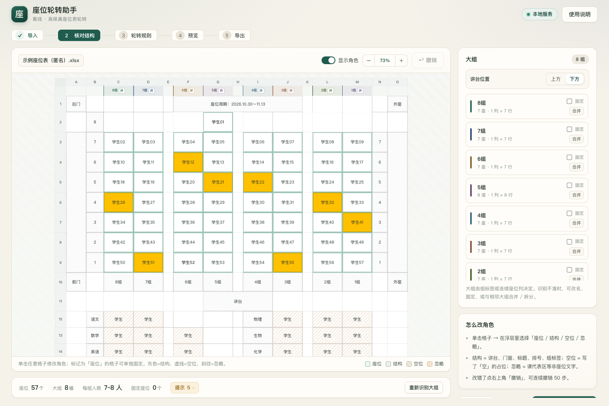
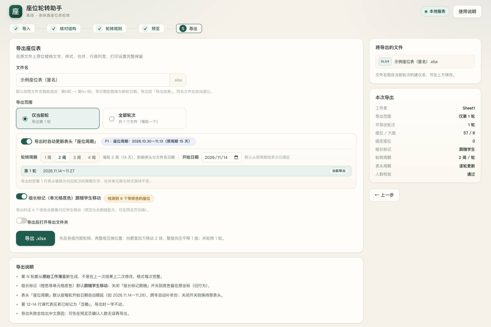

# 座位轮转助手（Seat Rotation Assistant）

[](https://github.com/Asteriya-PhD/seat-rotation-assistant/actions/workflows/build-windows.yml)


一个**完全离线**的本地小工具：导入现有 Excel 座位表（支持合并单元格、走道 / 讲台 / 门窗、复杂布局），
按规则轮转座位，再导出**保留原格式**的 Excel。给班主任个人使用。

## ⬇ 下载 Windows 免安装版

到 [**Releases**](https://github.com/Asteriya-PhD/seat-rotation-assistant/releases/latest) 下载：

- `SeatRotator-Windows-Portable.zip`

解压后双击 **`启动座位轮转助手.bat`** 即可，**不需要安装 Python**。
（首次运行如遇 SmartScreen 提示，点「更多信息 → 仍要运行」。）

## 🎬 宣传视频

[](docs/media/seat-app-promo-35s.mp4)

[▶ 观看 35 秒完整版（MP4，1080p，约 3.1 MB）](docs/media/seat-app-promo-35s.mp4)

[⬇ 或从 Releases 直接下载/播放](https://github.com/Asteriya-PhD/seat-rotation-assistant/releases/latest/download/seat-app-promo-35s.mp4)

> 视频使用匿名示例数据（学生01、学生02…），不含任何真实学生信息。

## 界面预览

| 导入 | 核对结构 |
| --- | --- |
|  |  |

| 轮转规则 | 预览 |
| --- | --- |
|  |  |

| 导出 |
| --- |
|  |

> 截图使用**匿名示例座位表**（学生01、学生02…），不含任何真实学生信息。

## 功能

- **任意格式座位表**：座位 / 讲台 / 门窗 / 走道 / 排号 / 大组标签 / 课代表区自动识别，可手工修正；
- **轮转规则**：前后、左右、前后+左右、整组互换、整组+组内、全班整体、自定义；步长 1~3；大组可固定；
- **组长标记跟随**：橙色底色随组长移动，可关闭；
- **表头周期自动更新**：识别「座位周期」并逐轮顺延；轮换周期可选每 1/2/3/4 周（默认 2 周 = 14 天）；
- **智能文件名**：第 N 轮 → 第 N+1 轮；文件名带日期则替换为新周期日期；多轮自动递增；
- **高保真导出**：保留合并单元格、边框、颜色、字体、行高列宽、打印设置、图片等原格式（XML 原位替换，不用 openpyxl 重建）。

## 使用（五步）

1. **导入**：把 `.xlsx` 座位表拖进页面（或点「选择文件」）；
2. **核对结构**：检查自动识别的座位、讲台、大组、固定座位，可点格子修正；
3. **轮转规则**：选预设或自定义（前后 / 左右 / 整组 / 组内），设置轮数；
4. **预览**：逐轮核对，可切换「标记跟随」查看组长底色；
5. **导出**：设置轮转周期与表头更新，导出到「导出结果」文件夹。

详细说明见 [`使用说明_Windows.txt`](使用说明_Windows.txt)（Windows 免安装版内也带同一份）。

## 在 macOS 上使用（源码运行）

需要 Python 3（macOS 一般自带）：

```bash
python3 app/server.py
```

或双击仓库里的 `启动.command`。

## 自行构建 / GitHub Actions

Windows 机器上：

```bat
py -3 -m pip install --upgrade pyinstaller
pyinstaller --noconfirm --clean --name SeatRotator --console --paths app --add-data "app/web;app/web" windows_entry.py
```

GitHub Actions 自动构建：push 到 `main` 或打 `v*` tag 时，Actions 会生成
`SeatRotator-Windows-Portable.zip`（artifact + Release 资产）；打 tag 会自动发布 Release。

## 隐私说明

- 本仓库内的示例座位表已**匿名化**（学生01、学生02…），**不含真实学生信息**；
- 本工具**完全离线**：只监听 `127.0.0.1`，不联网、不上传；
- 导入的表格、运行数据、导出文件只保存在本机程序所在文件夹（`数据/`、`导出结果/`）。

## 许可证

[MIT](LICENSE)
